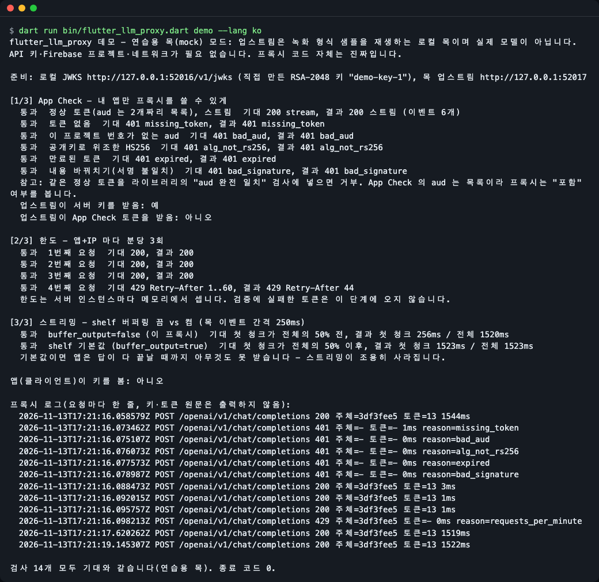
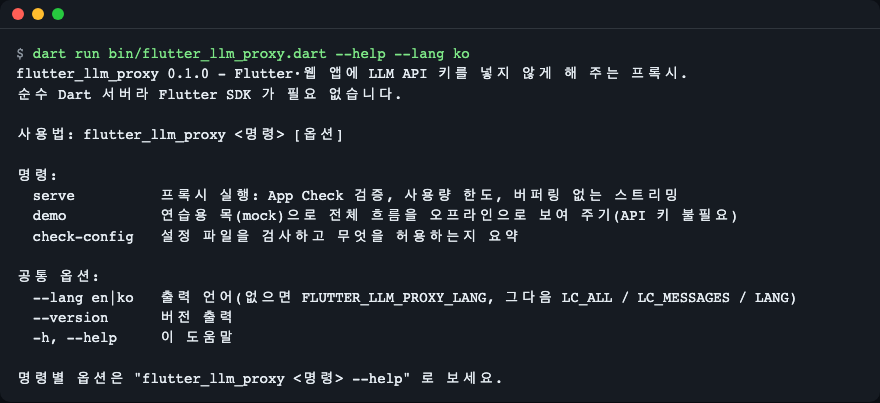
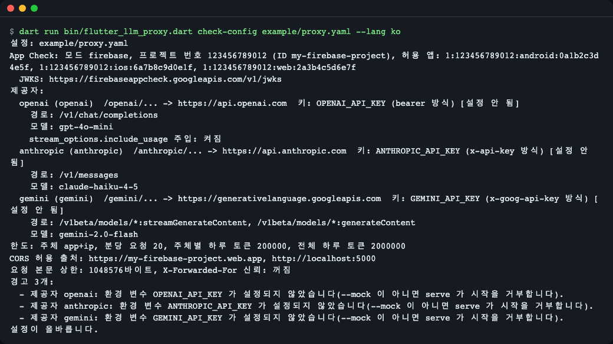
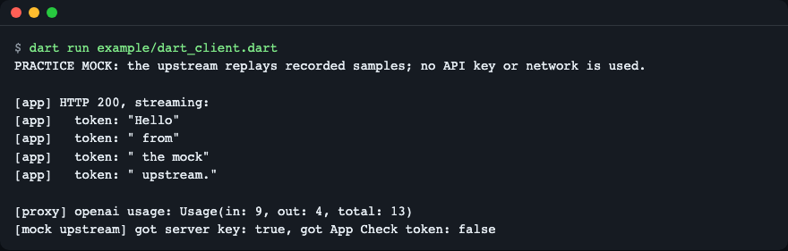
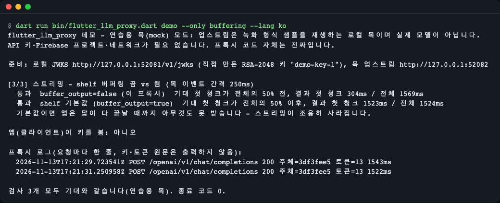
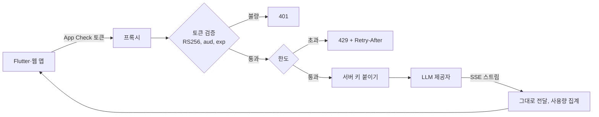

# flutter-llm-proxy

[English](README.md) | **한국어**

OpenAI·Anthropic·Gemini API 키를 Flutter·웹 앱 밖에 두게 해 주는 Dart(shelf) 프록시입니다. 요청마다 Firebase App Check 토큰을 검증하고, 앱별로 사용량을 제한하고, 답변을 버퍼링 없이 스트리밍으로 전달합니다. Flutter 앱에 LLM 기능을 붙이면서 매번 백엔드를 직접 짜고 싶지 않은 개발자를 위한 도구입니다. 키 없이 바로 체험: `dart run bin/flutter_llm_proxy.dart demo`.

앱 안에 넣은 API 키는 앱을 내려받은 누구나 꺼낼 수 있습니다. 이 도구는 대신 키를 들고 있는 작은 서버입니다. 앱은 "나는 진짜 내 앱이다"라는 짧은 증명(App Check 토큰)만 보내고, 서버가 키를 붙여 대신 호출합니다.


*`demo` 는 진짜 프록시 코드를 로컬 연습용 목에 연결해 앱이 보게 될 결과를 보여 줍니다. 정상 토큰은 200, 잘못된 토큰은 401, 한도 초과는 429.*

## 이런 분께
- Flutter 앱에 OpenAI·Anthropic·Gemini 기능을 넣는데 키가 앱 안에 들어가면 안 되는 경우
- 이미 Firebase(App Check)를 쓰지만 Gemini 말고 다른 제공자를 쓰고 싶고, 제공자마다 서버를 짜기 싫은 경우
- 빌드 산출물 검사에서 키가 발견되어 빨리 옮길 곳이 필요한 경우

## 설치

[Dart SDK](https://dart.dev/get-dart)(3.5 이상)가 필요합니다. Flutter SDK 는 필요 없습니다. 아직 pub.dev 에 없어서 clone 해서 씁니다.

```bash
brew install dart-sdk        # macOS, 리눅스는 https://dart.dev/get-dart
git clone https://github.com/LeeGyeongPil/flutter-llm-proxy.git
cd flutter-llm-proxy
dart pub get
dart run bin/flutter_llm_proxy.dart --version
```

```text
flutter_llm_proxy 0.1.0
```

## 빠르게 시작하기 (키·Firebase·네트워크 없이)

```bash
dart run bin/flutter_llm_proxy.dart demo --lang ko
```

**연습용 목(mock) 모드**입니다. 프록시 코드는 진짜지만 "업스트림"은 녹화 형식 샘플을 재생하는 로컬 목이고, App Check 토큰은 그 자리에서 만든 임시 키로 서명합니다. 실제 모델이 아니며 Firebase 와도 통신하지 않습니다. 모든 검사가 기대대로 나오면 종료 코드 0 으로 끝납니다.

맨 위 그림이 이 출력입니다. 읽는 법:
- `[1/3]` 정상 토큰은 200 스트림. 토큰 없음·다른 프로젝트·위조 HS256·만료·내용 바꿔치기는 각각 이유와 함께 401.
- `[2/3]` 1분 안의 4번째 요청은 `Retry-After` 와 함께 429.
- `[3/3]` shelf 기본값(`buffer_output=true`)에서는 답변이 다 끝나야 앱이 받기 시작합니다. 이 프록시는 버퍼링을 꺼서 첫 조각이 일찍 도착합니다.
- "업스트림이 서버 키를 받음: 예", "앱이 키를 봄: 아니오" 류의 줄: 키는 앱의 요청이 서버에 닿은 뒤에 붙고 앱으로는 돌아가지 않습니다.
- 로그에는 키와 토큰이 찍히지 않습니다.

## 사용법

| 명령 | 하는 일 | 예 |
|---|---|---|
| `serve` | 프록시 실행(App Check 검증, 한도, 스트리밍) | `dart run bin/flutter_llm_proxy.dart serve --config proxy.yaml` |
| `serve --mock` | 같지만 업스트림이 연습용 목(키 불필요) | `dart run bin/flutter_llm_proxy.dart serve --config example/proxy.yaml --mock` |
| `demo` | 오프라인 체험, 종료 코드 0/1 | `dart run bin/flutter_llm_proxy.dart demo --only buffering` |
| `check-config` | 설정 검사와 열려 있는 범위 요약 | `dart run bin/flutter_llm_proxy.dart check-config proxy.yaml --strict` |
| `--lang en\|ko` | 출력 언어 | `dart run bin/flutter_llm_proxy.dart --help --lang ko` |


*`--help` 는 세 명령과 전역 옵션을 보여 줍니다.*

### 1. 설정 점검

`example/proxy.yaml` 을 `proxy.yaml` 로 복사해 프로젝트 번호·앱 ID·모델·한도를 고친 뒤:

```bash
dart run bin/flutter_llm_proxy.dart check-config example/proxy.yaml --lang ko
```


*제공자별 업스트림, 키가 든 환경 변수(설정 여부만, 값은 절대 출력 안 함), 허용 경로·모델, 한도, 경고. 종료 코드 0 은 유효. `--strict` 에서는 경고가 있으면 1. 설정이 깨졌으면 줄 번호와 함께 2.*

### 2. 목으로 로컬 실행

```bash
dart run bin/flutter_llm_proxy.dart serve --config example/proxy.yaml --mock --port 18089
```

배너는 `MOCK MODE (practice)` 로 시작합니다. 다른 터미널에서 토큰 없이 요청하면 예상대로 거부됩니다.

```bash
curl -s -X POST localhost:18089/openai/v1/chat/completions -d '{}'
```

```text
{"error":{"type":"proxy_error","code":"app_check_failed","reason":"missing_token"}}
```

`curl -s localhost:18089/healthz` 는 `{"status":"ok"}` 를 돌려줍니다. Ctrl+C 로 멈춥니다.

### 3. 배포

실제 모드는 서버 환경 변수에서 키를 읽습니다([설정](#설정) 참고).

```bash
mkdir -p build
dart compile exe bin/flutter_llm_proxy.dart -o build/flutter-llm-proxy
OPENAI_API_KEY=... ./build/flutter-llm-proxy serve --config proxy.yaml
```

`providers` 에 적은 제공자는 모두 키 변수가 필요하므로, 쓰지 않는 제공자는 시작 전에 `proxy.yaml` 에서 지우세요(`example/proxy.yaml` 을 그대로 복사하면 키 3개가 모두 필요하고, 없으면 `serve` 가 종료 코드 2 로 끝납니다).

`Dockerfile` 도 있습니다(`docker build -t flutter-llm-proxy .`). Cloud Run·Docker·리버스 프록시 설명은 [doc/deploy.md](doc/deploy.md).

### 4. 앱에서 부르기

`X-Firebase-AppCheck` 헤더에 App Check 토큰을 싣고 기본 URL 만 프록시로 바꿉니다. Flutter 전체 예제는 [doc/flutter-client.md](doc/flutter-client.md).

### 5. 내 shelf 서버에 부품만 가져다 쓰기

```bash
dart run example/dart_client.dart
```


*예제는 한 프로세스에서 목 업스트림과 프록시를 띄우고 스트림 답변을 읽습니다. `appCheckMiddleware`·`rateLimitMiddleware`·`llmProxyHandler` 를 씁니다. 예제 코드라 출력은 영어뿐입니다.*

## 설정

YAML 파일 하나(`example/proxy.yaml` 에 줄마다 주석이 있습니다). 주요 항목:

| 키 | 뜻 |
|---|---|
| `providers` | 제공자별 URL 접두사, 업스트림, 키 환경 변수 이름, 키 헤더 방식, 허용 경로·모델 |
| `app_check` | `mode: firebase\|local\|off`, 프로젝트 번호·ID, 허용 앱 ID, 선택적 JWKS URL |
| `limits` | `subject: app\|ip\|app+ip`, 분당 요청 수, 일 토큰 수(주체별·전체) |
| `cors.allow_origins` | Flutter 웹에서 부를 수 있는 출처 |
| `max_body_bytes`, `trust_forwarded_for` | 요청 크기 제한. `X-Forwarded-For` 는 그것을 덮어쓰는 플랫폼 뒤에서만 신뢰 |

환경 변수(`.env.example` 참고): `OPENAI_API_KEY`, `ANTHROPIC_API_KEY`, `GEMINI_API_KEY`(이름은 `key_env` 로 변경 가능), `PORT`, `FLUTTER_LLM_PROXY_LANG`. 실제 모드는 설정된 키 변수가 비어 있으면 시작하지 않고, 목 모드는 필요 없습니다.

실제 모드와 목의 차이: 실제 답변은 제공자에서 오고 비용이 들며 지연은 제공자에 달려 있고, App Check 토큰은 내 Firebase 프로젝트에서 나와야 합니다. 목은 학습과 로컬 테스트용입니다.

**언어.** 출력은 영어 또는 한국어입니다. 우선순위: `--lang en|ko` > `FLUTTER_LLM_PROXY_LANG` > `LC_ALL` / `LC_MESSAGES` / `LANG`, 한국어가 아니면 영어. HTTP 오류의 `code`·`reason` 은 앱이 매칭하는 값이라 영어로 고정입니다.

```bash
dart run bin/flutter_llm_proxy.dart demo --only buffering --lang ko
FLUTTER_LLM_PROXY_LANG=en dart run bin/flutter_llm_proxy.dart demo --only buffering
```


*버퍼링 부분의 한국어 출력. 영어 README 에는 영어 출력이 있습니다.*

## 동작 원리



- 앱이 App Check 토큰을 보내면 프록시가 Firebase 의 공개 서명 키(JWKS)로 검증하므로 서비스 계정이 필요 없습니다.
- JWT 라이브러리를 부르기 전에 헤더 `alg` 를 RS256 으로 고정하고, `aud` 는 내 프로젝트 번호를 "포함"하는 목록인지 봅니다.
- 한도는 주체(앱, IP, 또는 둘 다)별 분당 요청 수와 일 토큰 수입니다. 카운트는 서버 인스턴스마다 메모리에 있습니다.
- 서버 키는 제공자로 가는 길에서만 붙습니다.
- 스트림 바이트는 바꾸지 않고 버퍼링 없이 전달합니다. 일 예산을 차감하려고 스트림에서 사용량을 읽습니다(OpenAI 마지막 usage 청크, Anthropic `message_delta`, Gemini `usageMetadata`). 앱 연결이 끊기면 업스트림 요청도 취소합니다.

## 보안 메모와 한계

- 토큰 헤더 `alg` 는 RS256 으로 고정하며 HS256·`none` 토큰은 거부합니다.
- `aud` 는 내 프로젝트 번호를 포함하는 목록이어야 합니다(App Check 토큰에는 항목이 둘 있습니다).
- `sub` 는 **앱 ID** 이고 모든 설치본이 같습니다. 앱별 한도는 사용자별·기기별 한도가 아닙니다.
- Firebase Admin SDK 없이는 토큰을 "사용됨"으로 표시할 수 없어, 탈취된 토큰은 만료 전까지 통합니다. App Check 토큰 수명을 짧게 두세요.
- 한도는 서버 인스턴스마다 메모리에 있고 재시작하면 초기화됩니다.
- 토큰 사용량은 제공자의 스트림에서 읽습니다. 제공자가 사용량을 보내지 않으면 그 호출은 일 예산에 0 토큰으로 계산되므로 분당 요청 한도가 안전망입니다.
- 허용 경로에서 `POST` 만 전달합니다. 다른 메서드는 `Allow: POST` 와 함께 `405 method_not_allowed` 를 받고 제공자에 닿지 않습니다. App Check 가 먼저 실행되므로 유효한 토큰이 없으면 메서드가 `POST` 가 아니어도 `401` 이 나오고, `405` 는 App Check 를 통과한 요청에서만 보입니다.

## 이 도구가 대신 막아 주는 함정

- **버퍼링된 스트림**: shelf 는 기본으로 출력을 버퍼링합니다. 프록시는 `buffer_output` 을 꺼서 SSE 조각이 만들어지는 대로 도착합니다(`demo` 의 버퍼링 부분 참고).
- **`aud` 는 문자열이 아니라 목록**입니다. 단순 일치 검사는 정상 토큰을 거부합니다.
- **Anthropic 사용량은 누적값**입니다(`message_delta` 마다). 프록시는 더하지 않고 마지막 값을 씁니다.
- **OpenAI 는 요청해야만 사용량을 보냅니다**: 프록시가 `stream_options.include_usage=true` 를 붙입니다(설정 `inject_include_usage`, 기본 켜짐).
- **키 교체**: 모르는 `kid` 의 토큰이 오면 JWKS 를 다시 받습니다(한 번에 하나, 10초 제한).

## 언제 쓰나

- 잘 맞는 경우: 작은 Flutter·웹 앱, 제공자가 여럿, 설정 파일 하나와 실행 파일 하나를 원하고 서버를 직접 돌려도 괜찮을 때.
- 다른 도구가 나은 경우: Gemini·Imagen 만 쓰고 서버를 두기 싫다면 [Firebase AI Logic](https://firebase.google.com/docs/ai-logic/app-check), 사용자 계정까지 갖춘 여러 팀용 대형 게이트웨이가 필요하다면 [LiteLLM](https://docs.litellm.ai/docs/proxy/token_auth).
- 한도는 인스턴스마다 따로 세며 공유되지 않습니다. 인스턴스를 하나로 두거나 적게 유지하세요. App Check 는 앱이 진짜임을 증명할 뿐 사용자가 누구인지는 증명하지 않습니다.

## 자주 겪는 문제

| 증상 | 원인 | 해결 |
|---|---|---|
| `401 app_check_failed`, `missing_token` | 앱이 `X-Firebase-AppCheck` 를 보내지 않음 | `FirebaseAppCheck.instance.getToken()` 결과를 그 헤더에 실어 보내기 |
| `401`, `bad_aud` | 설정의 `project_number` 가 틀림 | 프로젝트 ID 가 아니라 프로젝트 번호를 쓰기 |
| `serve` 가 시작하자마자 종료, 키 변수 없음 | 실제 모드는 서버 환경에 키가 필요 | 키를 설정하거나 `--mock` 으로 연습 |
| 스트리밍이 끝에 한꺼번에 보임 | 앞단 리버스 프록시가 버퍼링 | [doc/deploy.md](doc/deploy.md) 의 nginx 설명 참고 |
| `serve` 종료 코드 2 | 루프백이 아닌 주소에서 개발용 토큰·`mode: off` 사용 | 제거하거나 `127.0.0.1` 에서 실행 |
| 곧바로 `429` | 인스턴스별 한도 도달 | `Retry-After` 초만큼 기다리거나 한도 상향 |
| `405 method_not_allowed` | 허용 경로에서는 `POST` 만 전달(`Allow: POST`, CORS preflight 는 `POST, OPTIONS`) | 제공자 경로를 `POST` 로 호출 |

## 개발·기여

```bash
dart pub get
dart analyze
dart test
```

버그·제안은 이슈로 남겨 주세요. 변경 기록은 [CHANGELOG.md](CHANGELOG.md).

## 라이선스

MIT. 모델·데이터는 포함하지 않으며 목의 답변은 손으로 만든 짧은 샘플입니다.
