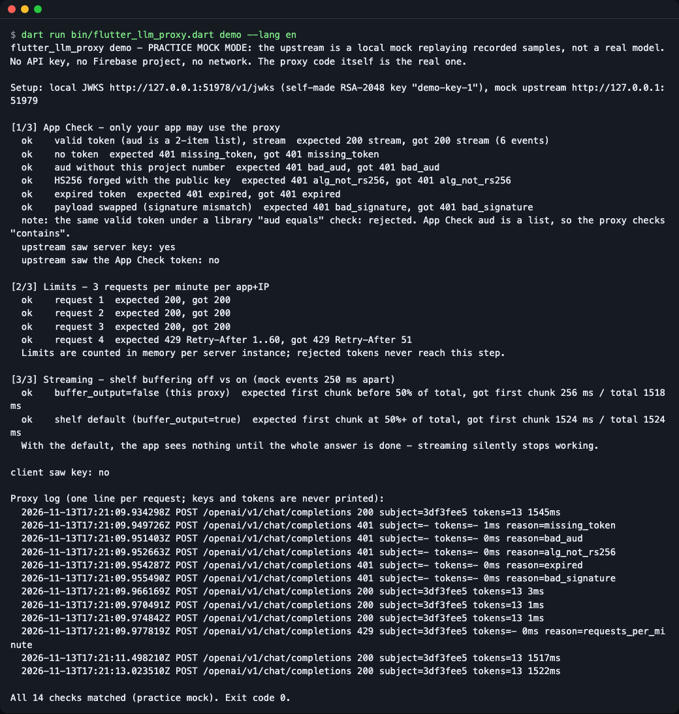
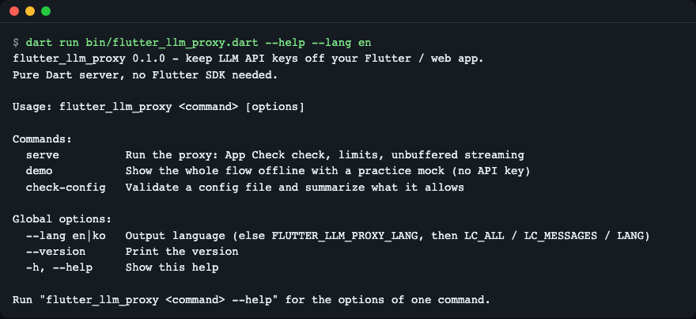
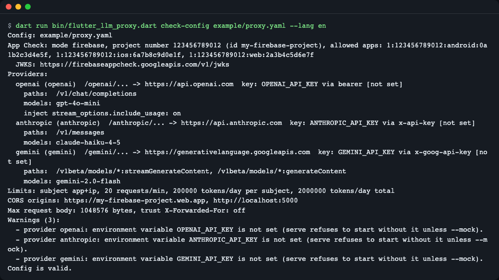
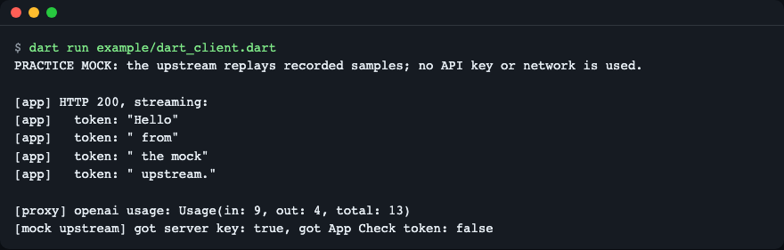
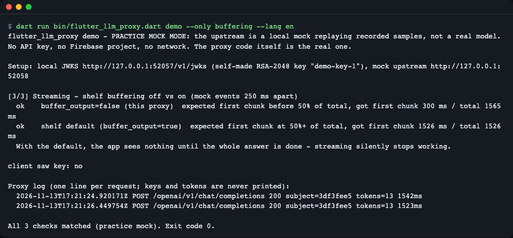
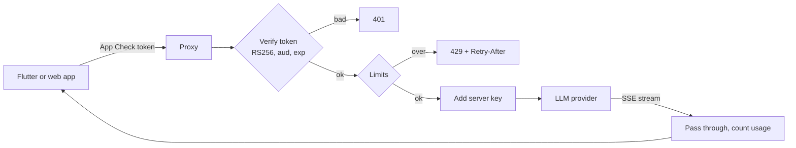

# flutter-llm-proxy

**English** | [한국어](README.ko.md)

A Dart (shelf) proxy that keeps OpenAI, Anthropic and Gemini API keys out of your Flutter or web app. It checks a Firebase App Check token on every request, limits usage per app, and streams answers without buffering. It is for developers who add LLM features to a Flutter app and do not want to write and run a backend each time. Try it without any key: `dart run bin/flutter_llm_proxy.dart demo`.

An API key inside an app can be extracted by anyone who downloads the app. This tool is the small server that holds the key instead. The app sends a short-lived proof that "this is my real app" (an App Check token), and the server adds the key and forwards the call.


*`demo` runs the real proxy against a local practice mock and prints what the app would see: 200 for a valid token, 401 for bad ones, 429 over the limit.*

## Who it is for
- You add an OpenAI, Anthropic or Gemini feature to a Flutter app and the key must not ship inside the app.
- You already use Firebase (App Check) but want a provider other than Gemini, without writing a server per provider.
- A build scan found a key in your app bundle and you need a quick place to move it to.

## Install

Needs the [Dart SDK](https://dart.dev/get-dart) (3.5 or newer). The Flutter SDK is not needed. It is not on pub.dev yet, so clone it:

```bash
brew install dart-sdk        # macOS; on Linux see https://dart.dev/get-dart
git clone https://github.com/LeeGyeongPil/flutter-llm-proxy.git
cd flutter-llm-proxy
dart pub get
dart run bin/flutter_llm_proxy.dart --version
```

```text
flutter_llm_proxy 0.1.0
```

## Quick start (no key, no Firebase, no network)

```bash
dart run bin/flutter_llm_proxy.dart demo --lang en
```

This is a **practice mock mode**. The proxy code is the real one, but the "upstream" is a local mock that replays recorded-format samples, and App Check tokens are signed with a throwaway key made on the spot. It is not a real model and it does not talk to Firebase. It ends with exit code 0 when every check behaves as expected.

The picture at the top shows this output. How to read it:
- `[1/3]` A valid token streams a 200 reply. A missing token, a wrong project, a forged HS256 token, an expired token and a tampered payload each get a 401 with a reason.
- `[2/3]` The fourth request within a minute gets 429 with `Retry-After`.
- `[3/3]` With the shelf default (`buffer_output=true`) the app sees nothing until the whole answer is done. This proxy turns buffering off, so the first piece arrives early.
- `upstream saw server key: yes` and `client saw key: no`: the key is added after the app's request reaches the server, and it never goes back.
- The log lines never contain keys or tokens.

## Usage

| Command | What it does | Example |
|---|---|---|
| `serve` | Run the proxy (App Check check, limits, streaming) | `dart run bin/flutter_llm_proxy.dart serve --config proxy.yaml` |
| `serve --mock` | Same, but the upstream is the practice mock (no key) | `dart run bin/flutter_llm_proxy.dart serve --config example/proxy.yaml --mock` |
| `demo` | Offline walkthrough with exit code 0/1 | `dart run bin/flutter_llm_proxy.dart demo --only buffering` |
| `check-config` | Validate a config and list what it opens | `dart run bin/flutter_llm_proxy.dart check-config proxy.yaml --strict` |
| `--lang en\|ko` | Output language | `dart run bin/flutter_llm_proxy.dart --help --lang en` |


*`--help` lists the three commands and the global options.*

### 1. Check a config

Copy `example/proxy.yaml` to `proxy.yaml`, edit the project number, app IDs, models and limits, then:

```bash
dart run bin/flutter_llm_proxy.dart check-config example/proxy.yaml --lang en
```


*Per provider: upstream, which environment variable holds the key (set or not, never the value), allowed paths and models, limits and warnings. Exit code 0 means valid. With `--strict`, any warning gives exit code 1. A broken file gives exit code 2 with the line number.*

### 2. Run locally with the mock

```bash
dart run bin/flutter_llm_proxy.dart serve --config example/proxy.yaml --mock --port 18089
```

The banner starts with `MOCK MODE (practice)`. In another terminal, a request without a token is refused, as it should be:

```bash
curl -s -X POST localhost:18089/openai/v1/chat/completions -d '{}'
```

```text
{"error":{"type":"proxy_error","code":"app_check_failed","reason":"missing_token"}}
```

`curl -s localhost:18089/healthz` returns `{"status":"ok"}`. Stop the server with Ctrl+C.

### 3. Deploy

Real mode reads the keys from server environment variables (see [Configuration](#configuration)):

```bash
mkdir -p build
dart compile exe bin/flutter_llm_proxy.dart -o build/flutter-llm-proxy
OPENAI_API_KEY=... ./build/flutter-llm-proxy serve --config proxy.yaml
```

Every provider listed in `providers` needs its key variable, so delete the providers you do not use from `proxy.yaml` before starting (a copy of `example/proxy.yaml` expects all three keys, otherwise `serve` exits with code 2).

A `Dockerfile` is included (`docker build -t flutter-llm-proxy .`). Cloud Run, Docker and reverse proxy notes are in [doc/deploy.md](doc/deploy.md).

### 4. Call it from the app

Send the App Check token in the `X-Firebase-AppCheck` header and point the base URL at the proxy. The full Flutter example is in [doc/flutter-client.md](doc/flutter-client.md).

### 5. Reuse the pieces in your own shelf server

```bash
dart run example/dart_client.dart
```


*The example starts a mock upstream and a proxy in one process, then reads a streamed answer. It uses `appCheckMiddleware`, `rateLimitMiddleware` and `llmProxyHandler`. Its output is English only because it is example code.*

## Configuration

One YAML file (`example/proxy.yaml` is commented line by line). Main sections:

| Key | Meaning |
|---|---|
| `providers` | Per provider: URL prefix, upstream, key environment variable name, key header style, allowed paths and models |
| `app_check` | `mode: firebase\|local\|off`, project number and ID, allowed app IDs, optional JWKS URL |
| `limits` | `subject: app\|ip\|app+ip`, requests per minute, tokens per day (per subject and total) |
| `cors.allow_origins` | Origins allowed for Flutter web |
| `max_body_bytes`, `trust_forwarded_for` | Request size limit; trust `X-Forwarded-For` only behind a platform that sets it |

Environment (see `.env.example`): `OPENAI_API_KEY`, `ANTHROPIC_API_KEY`, `GEMINI_API_KEY` (names can be changed with `key_env`), `PORT`, `FLUTTER_LLM_PROXY_LANG`. Real mode refuses to start while a configured key variable is empty; mock mode needs none.

Real mode differs from the mock: real answers come from the provider and cost money, latency depends on the provider, and App Check tokens must come from your Firebase project. The mock is only for learning and local tests.

**Language.** Output is English or Korean. Priority: `--lang en|ko`, then `FLUTTER_LLM_PROXY_LANG`, then `LC_ALL` / `LC_MESSAGES` / `LANG`; anything not Korean falls back to English. HTTP error `code` and `reason` values stay in English because apps match on them.

```bash
dart run bin/flutter_llm_proxy.dart demo --only buffering --lang en
FLUTTER_LLM_PROXY_LANG=ko dart run bin/flutter_llm_proxy.dart demo --only buffering
```


*English output of the buffering part; the Korean README shows the Korean output.*

## How it works



- The app sends its App Check token; the proxy fetches Firebase's public signing keys (JWKS), so no service account is needed.
- The header `alg` is pinned to RS256 before any JWT library runs, and `aud` is checked as a list that must contain your project number.
- Limits count requests per minute and tokens per day per subject (app, IP, or both). Counts live in memory per server instance.
- The server key is added only on the way to the provider.
- Streaming bytes pass through unchanged and unbuffered. Token usage is read from the stream (OpenAI final usage chunk, Anthropic `message_delta`, Gemini `usageMetadata`) to charge the daily budget. If the app disconnects, the upstream request is cancelled.

## Security notes and limits

- The token header `alg` is pinned to RS256; HS256 and `none` tokens are refused.
- `aud` must be a list that contains your project number (App Check tokens carry two entries).
- `sub` is the **app ID**, the same for every install. Limits per app are not limits per user or per device.
- Without the Firebase Admin SDK the proxy cannot mark a token as used, so a stolen token works until it expires. Keep App Check token lifetimes short.
- Limits live in memory per server instance and reset on restart.
- Token usage comes from the provider's stream. If a provider sends no usage, that call counts as 0 tokens against the daily budget, so the request-per-minute limit is your backstop.
- Only `POST` is forwarded on allowed paths. Other methods get `405 method_not_allowed` with `Allow: POST` and never reach the provider. App Check runs first, so a request without a valid token gets `401` even if its method is not `POST`; `405` appears only for requests that passed App Check.

## Pitfalls this tool handles

- **Buffered streams**: shelf buffers output by default; the proxy turns `buffer_output` off so SSE chunks arrive as they are produced (see the buffering part of `demo`).
- **`aud` is a list**, not a string; a plain equality check rejects valid tokens.
- **Anthropic usage is cumulative** across `message_delta` events; the proxy uses the last value instead of adding them up.
- **OpenAI sends usage only on request**: the proxy adds `stream_options.include_usage=true` (setting `inject_include_usage`, on by default).
- **Key rotation**: when a token has an unknown `kid`, the JWKS is fetched again (one fetch at a time, 10 s timeout).

## When to use it

- Good fit: a small Flutter or web app, several providers, you want one config file and one executable, and you are fine running a server.
- Use something else when: you only use Gemini or Imagen and want no server, see [Firebase AI Logic](https://firebase.google.com/docs/ai-logic/app-check); you need a large multi-team gateway with its own user accounts, see [LiteLLM](https://docs.litellm.ai/docs/proxy/token_auth).
- Limits are per instance and not shared. Run one instance, or keep the instance count small. App Check proves the app is genuine, not that the user is who they say.

## Troubleshooting

| Symptom | Cause | Fix |
|---|---|---|
| `401 app_check_failed`, `missing_token` | The app did not send `X-Firebase-AppCheck` | Send `FirebaseAppCheck.instance.getToken()` in that header |
| `401`, `bad_aud` | Wrong `project_number` in the config | Use the project number, not the project ID |
| `serve` exits at start, key variable missing | Real mode needs the key in the server environment | Set it, or add `--mock` to practice |
| Streaming shows everything at the end | A reverse proxy in front is buffering | See the nginx notes in [doc/deploy.md](doc/deploy.md) |
| Exit code 2 on `serve` | Dev tokens or `mode: off` on a non-loopback host | Remove them or listen on `127.0.0.1` |
| `429` right away | Per-instance limit reached | Wait `Retry-After` seconds or raise the limit |
| `405 method_not_allowed` | Only `POST` is forwarded on allowed paths (`Allow: POST`; CORS preflight is `POST, OPTIONS`) | Call the provider path with `POST` |

## Development

```bash
dart pub get
dart analyze
dart test
```

Bugs and ideas are welcome as issues. Changes are listed in [CHANGELOG.md](CHANGELOG.md).

## License

MIT. No model or data is bundled; the mock replies are small hand-made samples.
